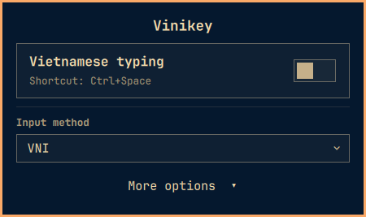
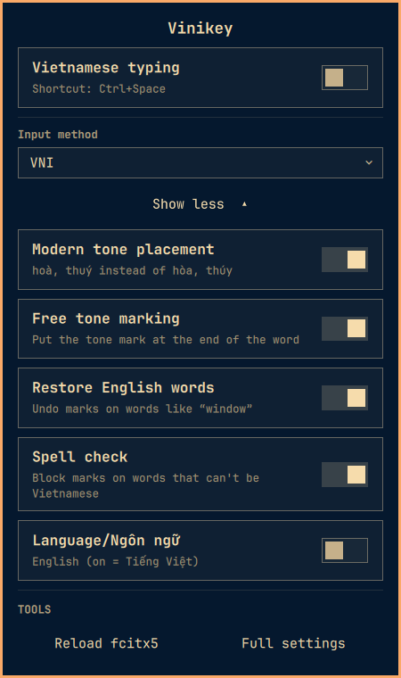
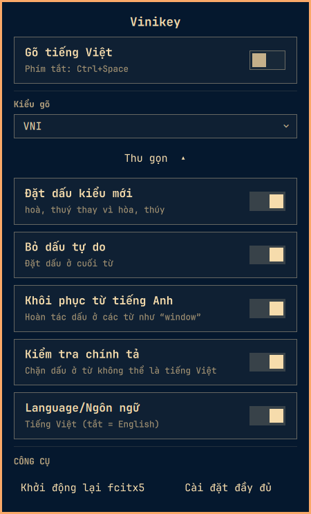

# Vinikey

[](https://github.com/rodonguyen/vinikey/actions/workflows/ci.yml)
[](CONTRIBUTING.md)

**Vietnamese typing on [Omarchy](https://omarchy.org), kept simple.**

A small `VI` / `EN` label in your bar, and one clean panel for
[fcitx5](https://github.com/fcitx/fcitx5) Bamboo. No config files to edit, no clutter.

<table>
  <tr>
    <td align="center" valign="top" width="33%">
      
    </td>
    <td align="center" valign="top" width="33%">
      
    </td>
    <td align="center" valign="top" width="33%">
      
    </td>
  </tr>
  <tr>
    <td align="center"><sub><b>Collapsed</b> (default)<br>typing switch and input method</sub></td>
    <td align="center"><sub><b>More options</b><br>typing options and tools</sub></td>
    <td align="center"><sub><b>Tiếng Việt</b><br>the panel's default language</sub></td>
  </tr>
</table>

- **Clean and simple.** Turn Vietnamese typing on or off and pick your typing style. Everything else stays tucked away under *More options*.
- **Type your way.** Telex, VNI, VIQR and more. Options like where tone marks go or spell checking take effect right away, with nothing to restart.
- **Prefer Ctrl+Shift?** One switch makes `Ctrl+Shift` change the language instead of `Ctrl+Space`.
- **In Vietnamese or English.** The panel is in whichever language you like.
- **Light.** It barely uses any memory or processor.

<sub>Tested on Omarchy with Hyprland 0.56.2, fcitx5 5.1.23 and fcitx5-bamboo 1.0.11.</sub>

## Install

```bash
omarchy plugin add https://github.com/rodonguyen/vinikey
~/.config/omarchy/plugins/rodonguyen.vinikey/install.sh
```

The script finishes the setup in one go and is safe to run again:

1. installs `fcitx5`, `fcitx5-bamboo` and `fcitx5-configtool` (pacman asks for your password),
2. adds Bamboo to fcitx5 (Telex, unless you already picked another method),
3. enables the bar widget,
4. builds the small helper that keeps the label instant (needs `base-devel`; without
   it the label updates every 1.5 s instead),
5. restarts the shell so the widget appears.

If a step fails, your fcitx5 config is restored. Skipped the script? When fcitx5 or
Bamboo is missing, the panel offers **Set up Vietnamese typing…**, which runs it in a
terminal for you. The indicator sits on the right of
the bar; move it with `omarchy bar move rodonguyen.vinikey --section center`.

**Update:** `omarchy plugin update rodonguyen.vinikey`, then `omarchy restart shell`.

### What it changes

| What | When | Undone by `uninstall.sh` |
|---|---|---|
| packages `fcitx5`, `fcitx5-bamboo`, `fcitx5-configtool` | only the missing ones | no: your typing setup stays |
| `~/.config/fcitx5/profile`: adds Bamboo, points `Ctrl+Space` at it | only if Bamboo isn't there yet; fcitx5 is stopped while editing, backup in `~/.local/state/vinikey/` | no |
| `~/.config/fcitx5/conf/bamboo.conf`: `InputMethod=Telex` | only if no method is set | no |
| the plugin folder and its entry in `~/.config/omarchy/shell.json` | always | yes |
| `~/.local/bin/fcitx5-im-watch` and `$XDG_RUNTIME_DIR/fcitx5-im-watch` | if a compiler is available | yes |

The panel's switches change Bamboo's options through fcitx5 itself, which saves
them in `bamboo.conf`. Nothing else is touched: no systemd overrides, no sudo
outside pacman.

## Use

| Action | What happens |
|---|---|
| `Ctrl+Space` (or your fcitx5 hotkey) | switch between English and Vietnamese; the label follows |
| Click the indicator | open the settings panel (click outside to close) |
| Panel: typing switch | switch language for the window you are typing in |
| Panel: input method dropdown | change Bamboo's typing method live |
| Panel: *More options* | expand the Ctrl+Shift, tone, English-restore, spell-check and language switches plus the Reload fcitx5 / Full settings tools (collapsed by default) |
| Panel: Switch with Ctrl+Shift | use Ctrl+Shift instead of Ctrl+Space to switch (off by default) |
| Panel: Language/Ngôn ngữ | switch the panel between Vietnamese and English |

The label reads `--` when fcitx5 is not running, and also when no window has keyboard
focus, because fcitx5 keeps one input state per window.

## Troubleshooting

- **`--` in the bar:** fcitx5 isn't running. Check
  `systemctl --user status omarchy-fcitx5.service`. Don't start `fcitx5` by hand
  while that service is enabled; the two fight over the D-Bus name.
- **`Ctrl+Space` seems to do nothing:** your profile's `DefaultIM` should be
  `bamboo` (the method `Ctrl+Space` switches to), not your plain keyboard. If you
  ever restored state with `fcitx5-remote -s <keyboard>`, reset it with
  `fcitx5-remote -s bamboo; fcitx5-remote -c`.
- **Label lags by a second:** the helper isn't built. Install `base-devel`, run
  `install.sh` again. Widget code changes always need `omarchy restart shell`.
- **Typing doesn't convert in one app:** check that the app has an input-method
  environment (`QT_IM_MODULE=fcitx`, and no `GTK_IM_MODULE` on Wayland).
- **Settings panel text is English/Vietnamese the wrong way round:** use the
  **Language/Ngôn ngữ** switch.

## Safety

Omarchy plugins are **not sandboxed**: they run inside the shell with your
permissions. This widget runs only: `fcitx5-remote`, `busctl` (to read and write
Bamboo's settings on the session bus), `pgrep`, `hyprctl` (to return focus to your
window), `systemctl --user restart omarchy-fcitx5.service`, `fcitx5-configtool`,
and the optional `~/.local/bin/fcitx5-im-watch`. It only reads from fcitx5 on every
poll and never auto-starts it. Read the code before installing; it is short.

## Uninstall

```bash
~/.config/omarchy/plugins/rodonguyen.vinikey/uninstall.sh
```

Removes the widget and its helper. Vietnamese typing keeps working without it; to
remove Bamboo too: `sudo pacman -Rns fcitx5-bamboo`.

## Contributing

Pull requests are welcome. [CONTRIBUTING.md](CONTRIBUTING.md) covers the dev setup,
the safety rules and the pull request checklist. Run the tests with:

```bash
bash tests/run.sh
omarchy plugin validate .
```

[docs/DESIGN.md](docs/DESIGN.md) has the requirements, how the widget talks to
fcitx5, and a list of gotchas that cost real debugging time.

## Tiếng Việt

Widget cho thanh bar của Omarchy, hiển thị bạn đang gõ **tiếng Việt (`VI`)** hay
**tiếng Anh (`EN`)** với fcitx5 + Bamboo. Bấm vào biểu tượng để mở bảng cài đặt:
đổi kiểu gõ (Telex, VNI, VIQR...), đặt dấu kiểu mới (`hoà`), bỏ dấu tự do, khôi phục
từ tiếng Anh, kiểm tra chính tả. Bảng mặc định bằng tiếng Việt; công tắc
**Language/Ngôn ngữ** đổi sang English.

Cài đặt bằng một lệnh (cài fcitx5 + Bamboo, bật widget, chạy lại an toàn):

```bash
omarchy plugin add https://github.com/rodonguyen/vinikey
~/.config/omarchy/plugins/rodonguyen.vinikey/install.sh
```

Phím tắt chuyển ngôn ngữ mặc định là `Ctrl+Space`.

## License

[MIT](LICENSE)
